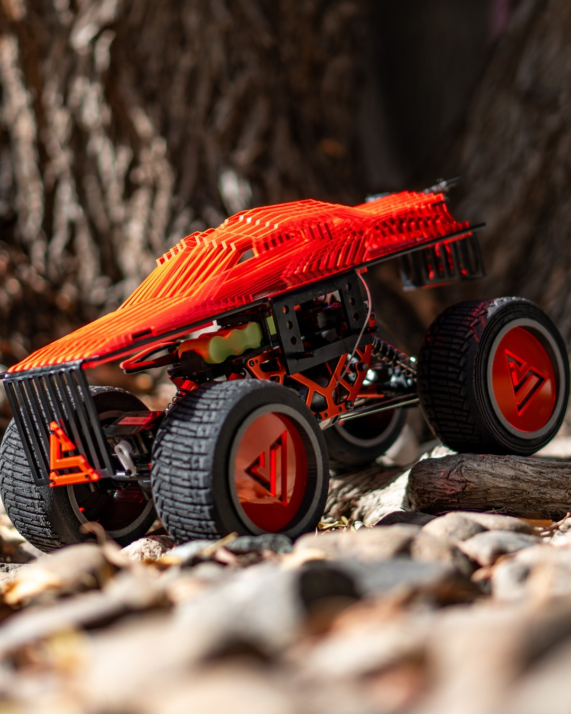

# Project Strata — 4x4 in Schools

Project Strata was Dubai College's team for the ADNOC Land Rover 4x4 in Schools UAE challenge. The work combined mechanical design, electronics, Arduino-based control, CAD, testing, and team presentation.

## Evidence

- [Official Project Strata Instagram](https://www.instagram.com/dubaicollege_projectstrata/)
- [Vehicle photo](photos/project-strata-red-vehicle.jpg)
- [CAD and fabrication work](photos/project-strata-cad-work.jpg)

The original team deck, `4x4 Verbal Presentation Project Strata.pptx`, is listed in the team's Microsoft Teams files. It will be included here as soon as the school SharePoint download is available outside the browser sign-in flow.
